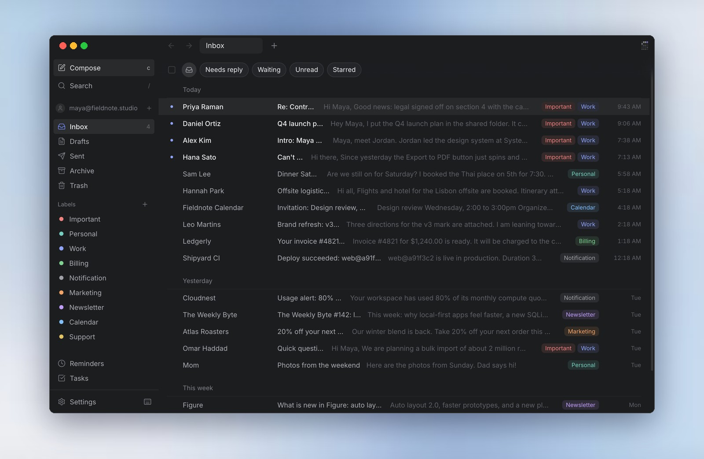
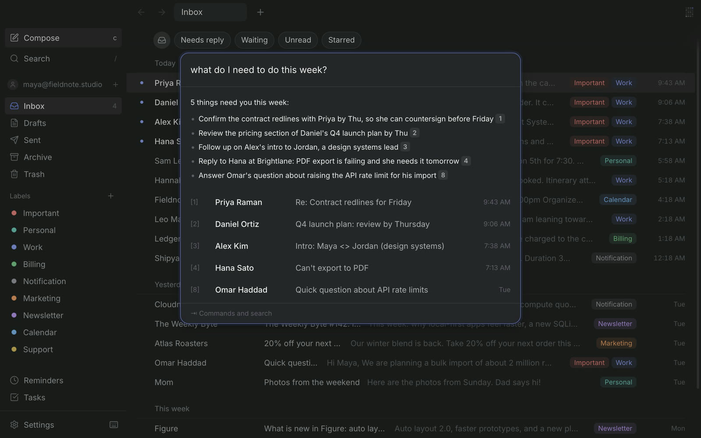
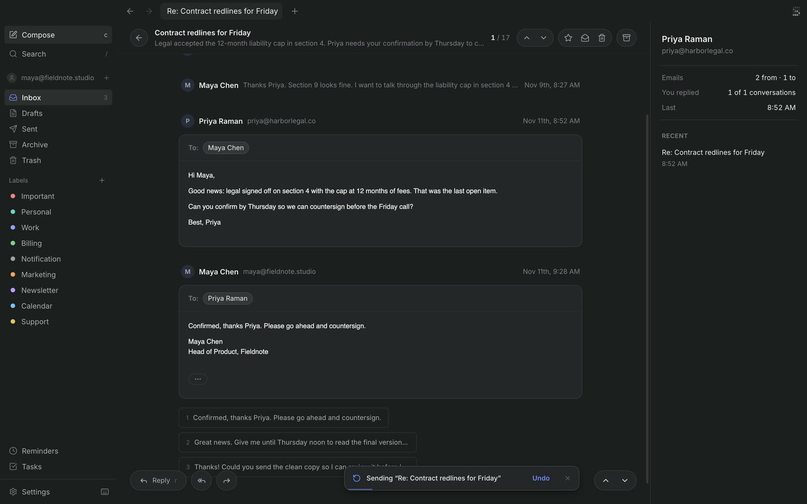
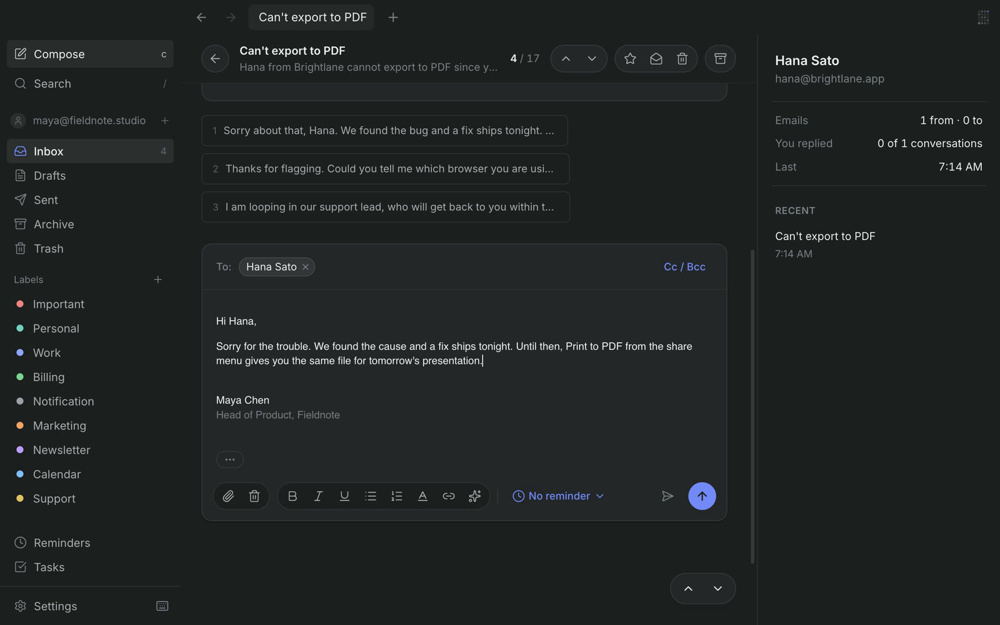
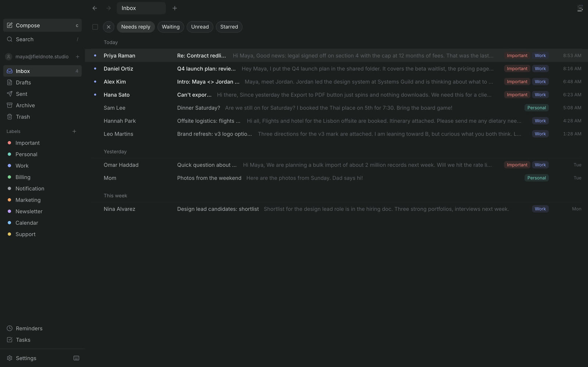
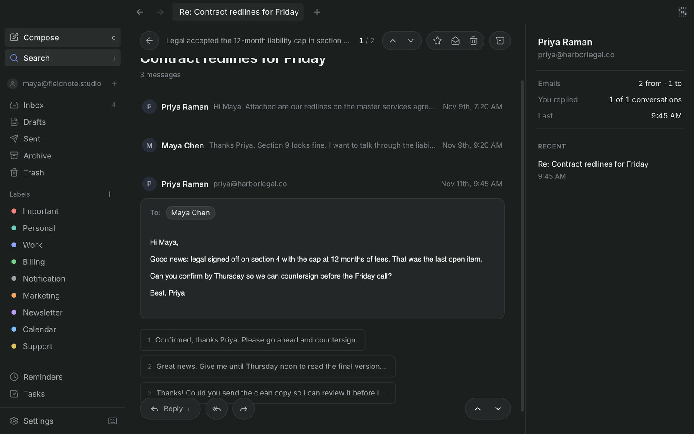
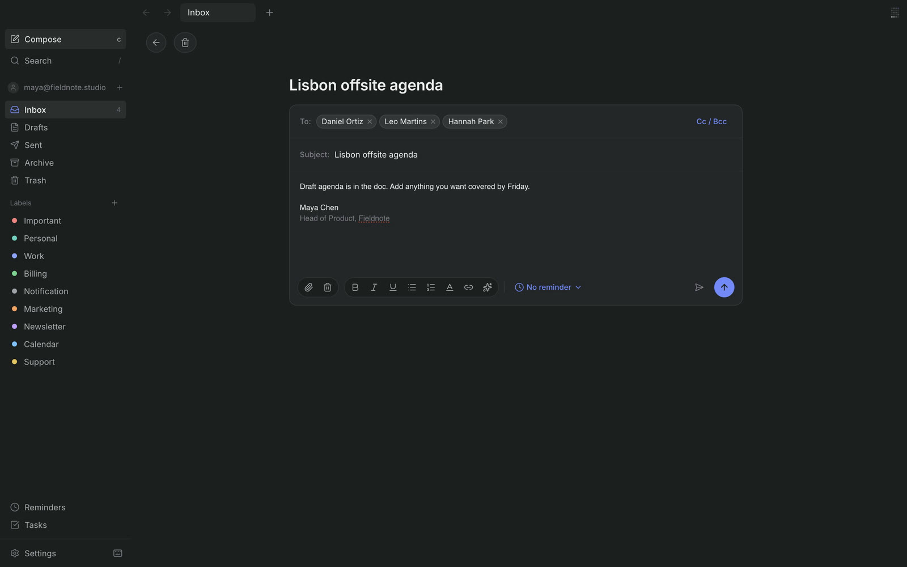

<h1 align="center">
   Sovo
</h1>

<p align="center">
  <a href="https://github.com/kaisenye/sovo/actions/workflows/ci.yml"></a>
  
  
  
</p>

<p align="center">
  <strong>Mail that keeps up with you.</strong><br />
  Local-first, keyboard-first desktop mail with AI on your own key. Gmail, Outlook and any IMAP inbox.
</p>

<h3 align="center"><a href="https://sovomail.xyz"><ins>Get Sovo at sovomail.xyz</ins></a></h3>

<p align="center">
  
</p>

<p align="center">
  <a href="#quick-start">Quick start</a> ·
  <a href="#configuration">Configuration</a> ·
  <a href="#architecture">Architecture</a> ·
  <a href="#shortcuts">Shortcuts</a>
</p>

## Features

<table>
<tr>
<td width="30%" valign="middle">

### Ask your inbox

Press <kbd>⌘J</kbd> and ask in plain words: "what do I need to do this week?" Answers cite the messages they came from, one keystroke away.

</td>
<td width="70%">
  <picture><source srcset="docs/assets/readme/ask-ai.webp" type="image/webp"></picture>
</td>
</tr>
<tr>
<td width="30%" valign="middle">

### Instant Reply

Three replies are written before you open the thread. Press <kbd>1</kbd>, <kbd>2</kbd> or <kbd>3</kbd> to use one, <kbd>⌘↵</kbd> to send, and it shows in the thread at once.

</td>
<td width="70%">
  <picture><source srcset="docs/assets/readme/instant-reply.webp" type="image/webp"></picture>
</td>
</tr>
<tr>
<td width="30%" valign="middle">

### Write with AI

In compose, <kbd>⌘J</kbd> drafts from a one-line instruction, using the conversation and how you have written to this person before.

</td>
<td width="70%">
  <picture><source srcset="docs/assets/readme/write-with-ai.webp" type="image/webp"></picture>
</td>
</tr>
<tr>
<td width="30%" valign="middle">

### Triage at the speed of keys

<kbd>E</kbd> marks done, <kbd>Z</kbd> undoes, <kbd>H</kbd> brings a thread back later. Filters like Needs reply cut the Inbox to what is on you.

</td>
<td width="70%">
  <picture><source srcset="docs/assets/readme/triage.webp" type="image/webp"></picture>
</td>
</tr>
<tr>
<td width="30%" valign="middle">

### Instant search

Every message is in a local full-text index, so results land as you type. Narrow with <code>from:</code>, <code>to:</code>, <code>subject:</code> and <code>is:</code>.

</td>
<td width="70%">
  <picture><source srcset="docs/assets/readme/search.webp" type="image/webp"></picture>
</td>
</tr>
<tr>
<td width="30%" valign="middle">

### Compose

Recipients complete from your own mail and turn into pills. Per-inbox signatures, send later, and an undo window on every send.

</td>
<td width="70%">
  <picture><source srcset="docs/assets/readme/compose.webp" type="image/webp"></picture>
</td>
</tr>
</table>

**Also in the box:**

- **Instant.** Every view paints from SQLite first; the network is a background refresh. New mail lands in 1–2 s over IMAP IDLE.
- **Yours.** No Sovo server. Credentials sit in the OS keychain, mail in a local database, and the whole mailbox works offline.
- **Any provider.** Gmail and Outlook over OAuth, plus any IMAP/SMTP host. Tuned for Tencent Exmail.
- **AI on your own key.** Anthropic, OpenAI or DeepSeek. Everything AI is off until you add a key, and a daily budget caps the spend.
- **Important / Other and labels.** Mail sorts itself into Important and categories, plus labels you describe in your own words.
- **Every key is remappable.** <kbd>⌘K</kbd> reaches everything else, with tabs, history and <kbd>⌃1</kbd>–<kbd>⌃9</kbd> to switch inboxes.

<sub>The recordings use a fictional mailbox.</sub>

## Quick start

Requires Node 20+ and [pnpm](https://pnpm.io).

```bash
git clone https://github.com/kaisenye/sovo.git
cd sovo
pnpm install
pnpm dev
```

The first run walks you through connecting an account. It fills in server
settings for known providers, checks IMAP and SMTP before saving, and stores
the password in your keychain.

| Script | |
|---|---|
| `pnpm dev` | Run the app with hot reload |
| `pnpm test` | Vitest |
| `pnpm typecheck` | Strict TypeScript |
| `pnpm build` | Production bundle |
| `pnpm dist:mac` | Package a `.dmg` |
| `pnpm ai:mock` | Local stand-in for the AI providers |

## Stack

| Layer | |
|---|---|
| Shell | Electron 43, electron-vite |
| UI | React 19, Zustand, TanStack Virtual |
| Storage | better-sqlite3 (WAL, FTS5) |
| Mail | ImapFlow, Nodemailer |
| Safety | DOMPurify + jsdom (sanitized in main), `safeStorage` keychain vault |
| AI | Anthropic and OpenAI SDKs, your own key |

## Configuration

Everything is optional. Put values in `.env.local` at the repo root (gitignored;
see [`.env.example`](./.env.example)).

| Variable | Purpose |
|---|---|
| `MAIN_VITE_GOOGLE_CLIENT_ID`, `MAIN_VITE_GOOGLE_CLIENT_SECRET` | Continue with Google |
| `MAIN_VITE_MS_CLIENT_ID` | Continue with Microsoft |
| `SOVO_EMAIL`, `SOVO_PASS`, `SOVO_NAME` | Pre-seed a password account instead of the setup screen |
| `SOVO_IMAP_HOST`, `SOVO_IMAP_PORT`, `SOVO_SMTP_HOST`, `SOVO_SMTP_PORT` | Servers for that account (default: Exmail) |
| `SOVO_ANTHROPIC_BASE_URL`, `SOVO_OPENAI_BASE_URL`, `SOVO_DEEPSEEK_BASE_URL`, `SOVO_TYPESAFE_BASE_URL` | Point AI at the mock server (dev only) |

`MAIN_VITE_*` values are baked in at build time, so restart `pnpm dev` after
changing them. The older `SUPERMAIL_*` and `ROMO_*` names still work.

<details>
<summary><b>Google OAuth client</b></summary>

1. Create a Google Cloud project and enable the **Gmail API**.
2. Google Auth Platform: user type **External**, status **Testing**, add yourself
   under **Test users**, and add the scope `https://mail.google.com/`.
3. Create an OAuth client of type **Desktop app** and copy the ID and secret.

In Testing, Google expires sign-ins after 7 days and Sovo shows a "sign in
again" banner. `Error 403: access_denied` means the account is not a test user.
</details>

<details>
<summary><b>Microsoft OAuth client</b></summary>

Register an Entra app for any tenant plus personal accounts. Add the *Mobile and
desktop applications* platform with redirect `http://localhost/callback`, turn
on **Allow public client flows**, and add the delegated permissions
`IMAP.AccessAsUser.All`, `SMTP.Send`, `offline_access`, `openid` and `email`.
</details>

<details>
<summary><b>Testing AI without spending money</b></summary>

```bash
pnpm ai:mock 4010
SOVO_ANTHROPIC_BASE_URL=http://127.0.0.1:4010 SOVO_OPENAI_BASE_URL=http://127.0.0.1:4010/v1 SOVO_DEEPSEEK_BASE_URL=http://127.0.0.1:4010 SOVO_TYPESAFE_BASE_URL=http://127.0.0.1:4010 pnpm dev
```

Any key works against the mock. A packaged build ignores both variables.
</details>

## Architecture

```
Renderer (React)        list · thread · compose · ⌘K · hotkeys
        │  window.api (preload, contextBridge)
Main (Electron)         SQLite · IMAP pool + IDLE · SMTP outbox
                        sanitizer · sync / history / AI workers
```

- **Main owns anything sensitive:** the database, credentials, network and HTML sanitizing. The renderer is UI only.
- **Optimistic writes:** SQLite first, then IMAP in a persisted background queue, with one undo window.
- **One connection pool** per account; IDLE watches Inbox and Sent for push.
- **Threading** joins by every Message-ID a message mentions, so it survives servers that strip `References`.

```
electron/            main process, IPC, preload, workers
src/core/store/      SQLite schema, migrations, list read model
src/core/sync/       IMAP sync, IDLE, pool, flag / move writers
src/core/send/       SMTP, outbox, schedule / undo send
src/core/triage/     done, remind, mute, unsubscribe, zero
src/core/ai/         AI mail features (prompts treat mail as data)
src/ui/              React app; commands.ts declares every action
```

Contributor and agent notes: [`CLAUDE.md`](./CLAUDE.md).

## Shortcuts

`⌘.` shows them all in the app, and Settings → Shortcuts remaps any of them.

<details>
<summary><b>Full list</b></summary>

| Key | Action |
|---|---|
| `j` / `k` | Next / previous |
| `↵` | Open |
| `c` | Compose |
| `r` / `↵` / `f` | Reply / reply all / forward (in a thread) |
| `e` / `⇧E` | Done / not done |
| `z` | Undo |
| `⌫` | Trash |
| `s` / `u` | Star / read–unread |
| `h` | Remind me |
| `v` / `l` | Move / Gmail label |
| `⇧M` / `!` | Mute / spam |
| `⌘U` | Unsubscribe |
| `x` · `⇧J` / `⇧K` · `⌘A` | Select · extend · select all |
| `Tab` / `⇧Tab` | Next / previous split |
| `/` | Search |
| `⌘K` | Command palette |
| `⌘J` | Ask AI (Write with AI in compose) |
| `1` – `3` | Instant Reply (in a thread) |
| `⌘T` / `⌘W` · `⌘1`–`⌘9` | New / close tab · jump to tab |
| `⌘[` / `⌘]` | Back / forward |
| `⌃1`–`⌃9` | Switch account |
| `⌘↵` · `⌘⇧↵` · `⌘⇧L` | Send · send + done · send later (in compose) |
| `⌘;` | Insert a snippet (in compose) |
| `g` then `i` `s` `t` `d` `j` `e` `h` | Inbox · sent · trash · drafts · junk · done · reminders |
| `⌘,` | Settings |
| `Esc` | Close · clear selection · back |

</details>

## Notes

- Scheduled sends and reminders only fire while the app is running.
- Exmail serves a limited window over IMAP; widen it in its admin console to sync older mail.
- Early software: try it on a secondary mailbox first if you are cautious.

## License

[MIT](./LICENSE) © 2026 [Kaisen Ye](https://github.com/kaisenye)
